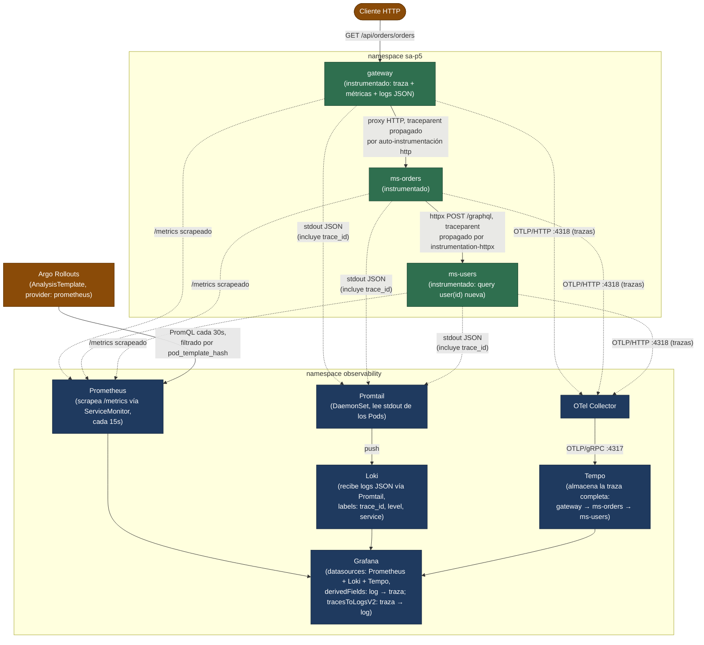

# Diagrama del flujo de telemetría (Práctica 10)

Enfocado en el **recorrido real de una petición y sus tres señales**
(traza, métrica, log), no en la arquitectura general del sistema (esa ya
existe en [P8/docs/gitops-flow.md](../../P8/docs/gitops-flow.md)).

## Recorrido síntoma → causa (lo que debe poder demostrarse)

1. **Alerta dispara** (`GatewayLatencySLOBurnRate`, ver
   [alerts.md](alerts.md)) → Alertmanager → (PENDIENTE: receiver real).
2. **Dashboard de Grafana** (panel "Latencia") muestra el p95 elevado y
   en qué ventana de tiempo.
3. **Explorar Tempo** desde Grafana, filtrando por el servicio `gateway`
   y ese rango de tiempo → se identifica una traza lenta real, con sus 3
   spans (`gateway` → `ms-orders` → `ms-users`).
4. **Saltar de la traza al log** (botón "Logs for this span" en Grafana,
   habilitado por `tracesToLogsV2` en el datasource de Tempo, ver
   [kube-prometheus-stack/values.yaml](../observability/kube-prometheus-stack/values.yaml))
   → el log JSON exacto de esa petición, con su `trace_id`, en Loki.
5. **Y en sentido inverso**: desde un log en Loki con un `trace_id`
   visible, el `derivedField` configurado en el datasource de Loki arma
   el enlace directo de vuelta a esa traza en Tempo.

## Estado real

PENDIENTE — este recorrido no se ha ejecutado todavía contra el clúster
real (el stack no está desplegado). Ver
[P10/docs/operation-report.md](operation-report.md), campo "Recorrido
hasta la causa", y [P10/scripts/](../scripts) para los scripts
preparados para generar la prueba real.
